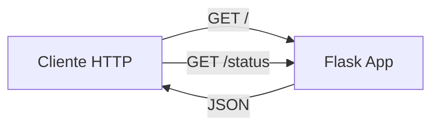
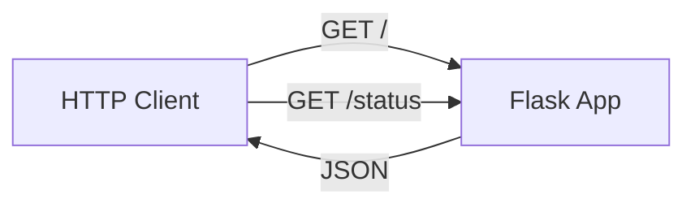

# Agile Final Project

Coursera - IBM DevOps and Software Engineering

[](https://python.org)
[](https://flask.palletsprojects.com)
[](LICENSE)
[](Dockerfile)

[English](#english) | [Portugues](#portugues)

---

## Portugues

### Visao Geral

Projeto final do curso **IBM DevOps and Software Engineering** na Coursera. O foco principal do curso era a metodologia Agile — criacao de User Stories, gerenciamento de Kanban board com GitHub Issues, e planejamento de sprints.

O codigo em si e uma aplicacao Flask minima (hello-world) com dois endpoints, usada como base para praticar o fluxo de trabalho Agile.

### Arquitetura



### Endpoints

| Rota | Metodo | Resposta |
|------|--------|----------|
| `/` | GET | `{"message": "Hello, Agile World!"}` |
| `/status` | GET | `{"status": "OK", "version": "1.0.0"}` |

### Como Executar

```bash
# Instalar dependencias
pip install -r requirements.txt

# Executar a aplicacao
python src/app.py

# Executar testes
pytest tests/test_app.py -v
```

### Estrutura do Projeto

```
Agile-Final-Project/
├── src/
│   └── app.py              # Aplicacao Flask (2 endpoints)
├── tests/
│   └── test_app.py         # Testes unitarios
├── .github/
│   └── ISSUE_TEMPLATE/
│       └── user_story.md   # Template para User Stories
├── LICENSE
├── README.md
└── requirements.txt
```

### Tecnologias

| Tecnologia | Uso |
|------------|-----|
| Python | Linguagem principal |
| Flask | Framework web |
| pytest | Testes |

---

## English

### Overview

Final project for the **IBM DevOps and Software Engineering** course on Coursera. The main focus of the course was Agile methodology — creating User Stories, managing a Kanban board with GitHub Issues, and sprint planning.

The code itself is a minimal Flask application (hello-world) with two endpoints, used as a base to practice the Agile workflow.

### Architecture



### Endpoints

| Route | Method | Response |
|-------|--------|----------|
| `/` | GET | `{"message": "Hello, Agile World!"}` |
| `/status` | GET | `{"status": "OK", "version": "1.0.0"}` |

### How to Run

```bash
# Install dependencies
pip install -r requirements.txt

# Run the application
python src/app.py

# Run tests
pytest tests/test_app.py -v
```

### Project Structure

```
Agile-Final-Project/
├── src/
│   └── app.py              # Flask application (2 endpoints)
├── tests/
│   └── test_app.py         # Unit tests
├── .github/
│   └── ISSUE_TEMPLATE/
│       └── user_story.md   # User Story template
├── LICENSE
├── README.md
└── requirements.txt
```

### Technologies

| Technology | Usage |
|------------|-------|
| Python | Core language |
| Flask | Web framework |
| pytest | Testing |

---

**Autor / Author:** Gabriel Demetrios Lafis
- GitHub: [@galafis](https://github.com/galafis)
- LinkedIn: [Gabriel Demetrios Lafis](https://linkedin.com/in/gabriel-demetrios-lafis)
